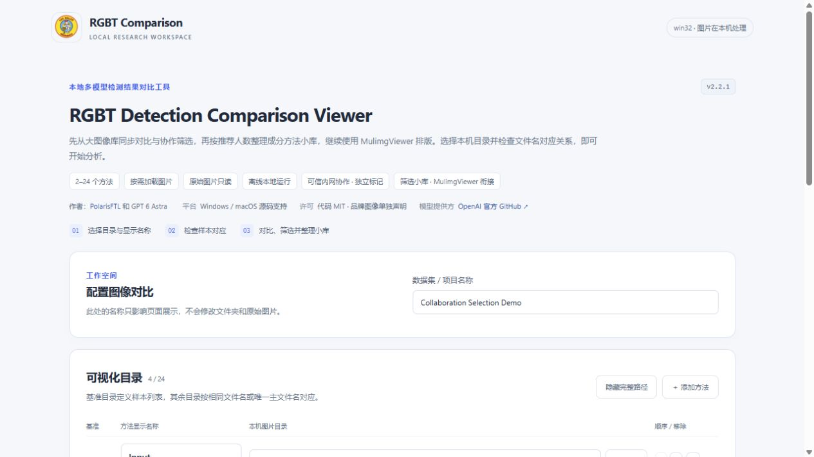
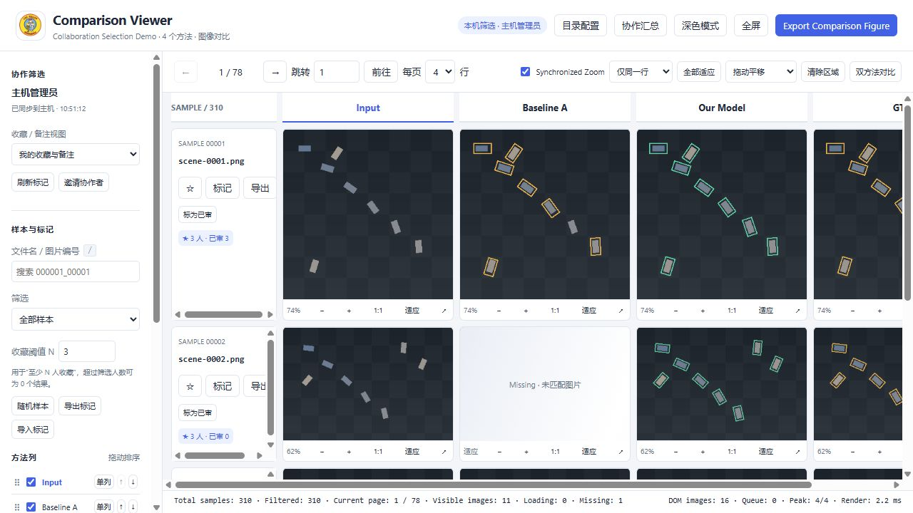
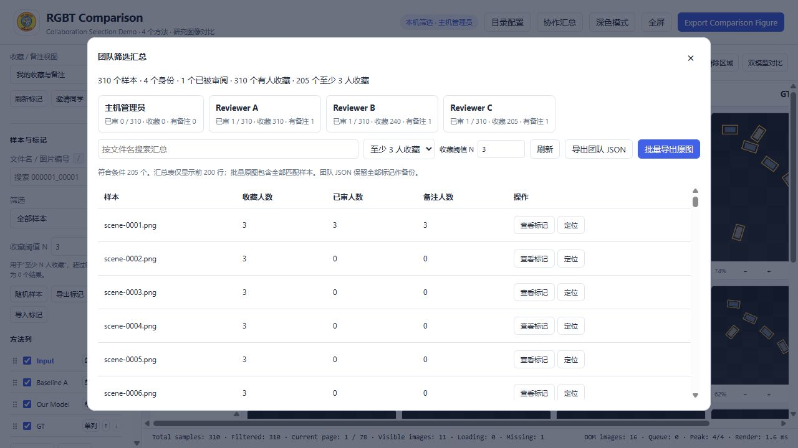

**简体中文** | [English](README_EN.md)

<p align="center"></p>

# RGBT Detection Comparison Viewer

本地图像对比、多人筛选与论文制图工具。面向 RGB-T 目标检测等实验结果，也可比较其他按样本对应的图像。**原始图片只读，运行时不依赖 CDN、npm 或在线 API。**

作者：[PolarisFTL](https://github.com/PolarisFTL) 与 GPT 6 Astra（AI 编程协作，提供方 [OpenAI](https://openai.com/)）。

**大库按需浏览 → 多人独立标记 → 至少 N 人推荐 → 导出分方法小库 → MulimgViewer 排版。** 也可直接在本工具预览、导出原始像素 PNG 拼图。

## 下载与启动

**[下载 v2.2.1 与校验文件](https://github.com/PolarisFTL/rgbt-comparison-viewer/releases/tag/v2.2.1)**

| 使用方式 | 下载 | 运行要求 |
|---|---|---|
| Windows x64 便携包（推荐） | [便携 ZIP](https://github.com/PolarisFTL/rgbt-comparison-viewer/releases/download/v2.2.1/RGBT-Comparison-Viewer-windows-amd64-portable.zip) | 解压后双击 `RGBTViewer.exe`，无需安装 Python、Node 或 .NET |
| Windows 单文件 | [RGBTViewer.exe](https://github.com/PolarisFTL/rgbt-comparison-viewer/releases/download/v2.2.1/RGBTViewer.exe) | 内含运行环境；建议放入可写目录 |
| Windows / macOS 源码 | [源码 ZIP](https://github.com/PolarisFTL/rgbt-comparison-viewer/releases/download/v2.2.1/RGBT-Comparison-Viewer-source.zip) | 主机 Python 3.9+，运行时仅标准库；协作访问者只需浏览器 |

1. **启动。** Windows 便携包双击 EXE；源码版 Windows 双击 `Start-Windows.bat`，macOS 双击 `Start-macOS.command`。源码包须完整解压到可写目录。
2. **配置。** 在欢迎页填写数据集名，选择 **2-24 个图片目录**，指定基准方法，编辑各列显示名。
3. **检查并浏览。** 查看匹配审计后进入工作台；默认每页 4 行，方法按列排列。配置可保存复用。

macOS 当前提供源码与启动器，**Windows EXE 不能在 Mac 直接运行，尚未提供经过 Mac 实机验收的 `.app`**。需要脚本执行权限时，在项目目录运行 `chmod +x Start-macOS.command Start-LAN-macOS.command`，或执行 `bash Start-macOS.command`。完整的 Python、Tk、目录与系统提示处理见 [Mac 启动指南](docs/MACOS.md)。本工具使用本地服务，直接双击 `index.html` 不能代替启动器。

## 图片目录要求

基准目录定义样本集合，同一行必须对应同一样本。例如：

```text
Input/       sample_001.jpg  sample_002.jpg
Baseline/    sample_001.png  sample_002.png
Ours/        sample_001.png  sample_002.png
GT/          sample_001.png  sample_002.png
```

- 完整文件名精确匹配优先；扩展名不同、主文件名唯一时允许安全对应。
- 不按各目录排序后的第 N 张配对，不猜测前后缀；缺失显示 `Missing`，歧义拒绝匹配。
- 方法显示名可改，**源文件夹和图片不改名**。嵌套、重复主名、额外文件及缺失数量进入审计。
- 输出应具有可比较的场景、视野和方向。相同名称或分辨率不能证明空间配准；工具不修改检测框或置信度。
- 推荐 PNG / JPEG；其他格式能否解码取决于浏览器。检查文件头不等于全库图片完整性验证。

## 浏览与论文制图

- 分页、文件名搜索、完整／缺失／收藏筛选、随机跳转和位置记忆。
- 列隐藏、排序、单列查看，列宽与间距调整，明暗主题。
- `Ctrl + 滚轮` 以指针缩放，拖动平移，双击适应；同步同一行或当前页的归一化视野。普通滚轮仍滚动页面。
- 原图详情、局部区域 ROI、任意双方法并排；同尺寸图片可使用分割线，工具不自动配准。
- 收藏、备注、标签和已审记录；`/` 聚焦搜索，输入框外左右方向键翻页。
- PNG 默认 **原始像素 1:1**，可调横纵间距、边距、标题和编号；另一模式明确按自定义总宽缩放。预览显示缩小不改变 PNG 像素。

十列各宽 840px 的图，内容本身就需要 8400px，不能在 3200px 总宽中保持原像素。PNG 无损编码或提高 DPI 都不能恢复缩放丢失的信息。大画布会先检查预算，超限可拆分；原像素模式不偷偷降采样。详见[使用教程](docs/QUICKSTART.md)。

## 多人协作与精选小库

默认只监听本机 `127.0.0.1`，端口 `8770`。需要可信内网协作时，使用 `Start-LAN-Windows.bat` 或 `Start-LAN-macOS.command`，由主机分享实际邀请地址与口令。每人使用昵称及恢复码认领身份，标记独立保存于主机 SQLite。

团队筛选支持任意人收藏、至少 N 人收藏、有备注／标签、全队未审和全部样本，可叠加文件名查询。**汇总列表最多显示前 200 行；批量导出处理全部匹配样本，不被这 200 行截断。**

在“团队汇总”点击“批量导出原图”，先预览再确认。默认全部方法，包含主页面隐藏列，可主动选子集：

- **主机复制：**选择已有可写目标目录，创建全新批次，按方法复制原文件，不覆盖原图或旧批次。
- **访问者下载：**下载 ZIP 到自己电脑，完整解压，再填写批次目录本身以生成本机绝对路径。不能把主机盘符当作自己的路径。
- **继续排版：**成功窗可复制单个或全部方法目录；扩展名不同时，可下载 MulimgViewer 专用 CSV。该 CSV 无表头／BOM，每行一个样本、每列一个方法，只包含完整复制行。`manifest.csv` 是带表头审计表，不能直接作图片列表；不假改后缀。
- **稍后重用：**批次含 `report.json`、`paths.txt`、审计及对应清单。`paths.txt` 是相对方法名，应与实际批次绝对路径拼接。取消保留已完成副本与不完整报告，未完成 ZIP 不提供下载。

完整流程：[中文小库教程](docs/BATCH_EXPORT.md) / [English workflow](docs/BATCH_EXPORT_EN.md)。MulimgViewer CSV 格式按官方代码核对，未把外部 GUI 导入标为本轮实测通过。

主机需要保持运行和唤醒；校园网可能有 VLAN、无线隔离或防火墙限制。此模式使用 **HTTP、无 TLS**，适用于获准查看数据的可信私有网段，不能作为公网服务直接开放。目录配置和主机系统操作只供主机管理，访问者仅获得授权图片及筛选功能。[内网说明](docs/LAN_COLLABORATION.md)

## 为什么不用一次加载整个图库

索引保存文件和对应关系；图片通过分页、IntersectionObserver 和 **4 个并发加载任务**按需读取。换页取消过时请求、移除旧节点并释放图像引用。默认 4 行、10 方法时为 40 个图像单元，方法数改变时单元数也会改变。

| 已执行的场景 | 证据与范围 |
|---|---|
| 大库审计基线 | 8,980 样本、10 方法、89,800 文件；索引扫描匹配 8.386 秒，未全量像素解码 |
| 2.2 实际浏览 | 1,503 × 10 数据副本连续翻页 20 次，矩阵始终 40 个图片节点，无控制台错误 |
| 超过 200 行的筛选 | 合成 310 × 4，N=3 得到 205 样本；复制 819 原图，1 Missing，819 个 SHA256 均与源一致 |
| 真实小批次 | N=2 筛出 20 × 10，200 文件哈希全同，含验证 5.516 秒，仅代表该批次 |
| 2.2 回归基线 | Python 123 项：122 通过、1 权限跳过；JS 65 项及另 4 项真实 Canvas／PNG 检查通过 |

上述为本机 Windows 功能基线，发布版本的附加检查见 [TESTING.md](docs/TESTING.md)。稳定节点数不等于进程内存恒定；巨幅图片、多人并发和导出仍会增加磁盘、网络及内存负载，不承诺任何设备永不卡顿。

## 合成示例截图

截图仅使用合成 OBB 图，不公开真实实验图片。

<details>
<summary>展开：目录配置、对比工作台、团队筛选与批量导出</summary>






</details>

## 文档、开发与边界

| 文档 | 内容 |
|---|---|
| [QUICKSTART](docs/QUICKSTART.md) / [MACOS](docs/MACOS.md) | 启动、快捷键、配置和 Mac 排障 |
| [BATCH_EXPORT](docs/BATCH_EXPORT.md) / [English](docs/BATCH_EXPORT_EN.md) | 从大库筛选到 MulimgViewer 小库 |
| [架构与性能](docs/ARCHITECTURE_PERFORMANCE.md) / [内网](docs/LAN_COLLABORATION.md) | 按需加载、资源边界与协作权限 |
| [中文报告](docs/技术与使用报告-中文.pdf) / [English report](docs/Technical-and-User-Report-English.pdf) | 技术与使用 PDF，宋体／Times New Roman 子集嵌入 |
| [TESTING](docs/TESTING.md) / [PUBLISHING](docs/PUBLISHING.md) | 实测、未验证项目与干净打包 |

源码运行不需要 Node；开发测试入口为 `python -m unittest discover -s tests -p "test_*.py"`。仓库提供 Windows/macOS [CI 工作流](https://github.com/PolarisFTL/rgbt-comparison-viewer/actions)，实际执行状态以 Actions 为准，CI 不代替原生 GUI 验收。

尚未完成 Mac 实机、原生目录对话框 GUI、外部 MulimgViewer GUI、真实第二台校园网设备和长期进程内存验收。默认 `local/` 已忽略；自定义 workspace 请放仓库外或另加忽略规则。配置、索引、口令、SQLite、标记、导出和真实实验图不提交 GitHub；正式发布使用白名单源码包。

代码与文档采用 [MIT](LICENSE)。**Los Pollos Hermanos 标识是第三方图像／商标，不包含在 MIT 代码许可中**；相关权利属于各自权利人，本项目不声明官方关联或赞助。见[资源权属说明](assets/README.md)。
