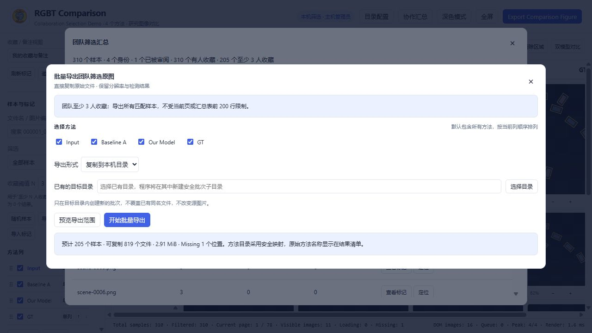
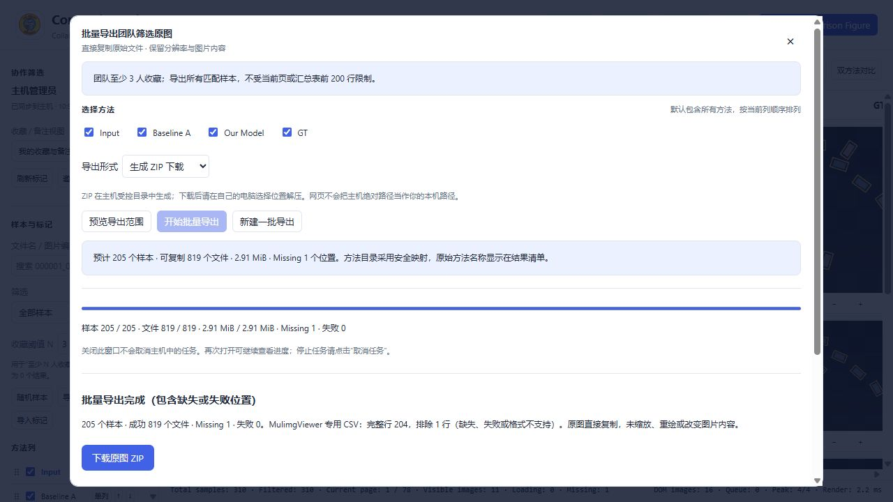

# 2.2 Selected-library export and MulimgViewer workflow

## 1. Use the large library for review, the small library for layout

Browse and compare the full dataset here with lazy loading, then review it independently with your collaborators. Filter representative samples by recommendation count or other team criteria, copy only those original files into method folders, and continue figure layout in MulimgViewer.

**Review large library → threshold N → confirm samples and methods → copy a small library or download ZIP → prepare local paths → MulimgViewer.**

This differs from PNG montage export: it keeps individual original files instead of creating one canvas. Images are not resized, cropped, enhanced, or re-encoded. ZIP is a container; extracted image content should remain identical to the copied source files.

## 2. Team selection semantics

Filename queries apply to the complete result set for the selected mode. The summary list displays at most the first 200 rows; **batch export includes all matching samples**, beyond that display limit.

| Mode | Meaning |
|---|---|
| Any favorite | At least one reviewer favorited the sample |
| At least N recommendations | Favorite count is greater than or equal to N |
| Notes or tags | Any reviewer has a note or at least one tag |
| Team unreviewed | No reviewer marked it reviewed, not merely “unreviewed by me” |
| All samples | Entire current dataset, with optional filename query |

Distinct reviewer identities determine the count. Repeated clicks do not create extra votes. A threshold is a count, not a model-quality score. If the result is empty, change the selection before exporting.

## 3. Preview before creating files

1. Check the mode, N, query, and matching sample count.
2. In the team summary, click “批量导出原图” (Batch export originals), then “预览导出范围” (Preview scope). Check sample/method counts, available and missing files, and estimated size.
3. All methods are selected by default, **including columns hidden in the viewer**. Explicitly deselect methods you do not need.
4. Inspect missing/error information. A different sample is never substituted.
5. Click “开始批量导出” (Start batch export), follow progress, then inspect the report. Cancellation retains completed copies and a partial report. An unfinished ZIP is not offered for download; its staged copies remain on the host, not on the visitor's computer.

The first 200 visible summary rows are not necessarily the whole selection. Visible columns are not the export-method selection. The preview defines the actual batch.



## 4. Host: copy into a new batch

Select host-directory copy and choose an existing writable destination folder, or choose ZIP download. The application creates a fresh batch and does not overwrite originals, existing files, or old batches. Method display names map to Windows/macOS-safe folder names; the report explains reserved names, invalid characters, and collisions. Original method directories are not renamed.

The destination cannot be inside source-image folders or protected code/index/database areas. Use workspace `exports` or a writable location outside the project. A folder created in the native picker and then selected already exists when the request is submitted.

The success dialog offers one or all absolute method paths. Optional double quotes are useful only if the receiving application expects them. `paths.txt` contains relative method-folder names, not independently usable absolute paths. On reopening, combine them with the actual batch root, or fill that root in the result dialog. `report.json` retains mappings. Regenerate after moving.

Illustrative structure; actual names come from the result:

```text
new-batch/
  Input/...
  Baseline/...
  Ours/...
  paths.txt                relative method folders
  report.json
  README.md                batch instructions
  manifest.csv             headered/BOM audit list
  MulimgViewer.csv          host-folder export: absolute paths
  mulimg-relative.csv       ZIP: relative reference only
```

## 5. Visitor: download, extract, then prepare local paths

Visitors cannot open the host's native destination picker or use a host drive letter as their own save location. Download the ZIP through the browser to your computer. **Extract the full batch before preparing paths and opening it in MulimgViewer.**

After “下载原图 ZIP” (Download originals ZIP), extract the complete batch. In the success dialog, fill “你电脑上已解压的批次目录” (Extracted batch folder on your computer) with the **batch folder itself**: its direct children should be the method folders, not another batch-name layer. Then click “下载 MulimgViewer 导入 CSV” (Download MulimgViewer CSV). Method paths are rebuilt from this device-local root. Surrounding quotes in a pasted root are removed; CSV quoting is generated automatically.

Relative locations only describe file relationships. Do not assume MulimgViewer resolves them against the CSV folder. Repeat path preparation after moving or transferring the batch. This changes lists, not image content, and the browser step does not require installing Python.



Mac paths, Windows drive letters, and host-local paths are not interchangeable. The browser controls its download destination; a webpage cannot guess the extracted folder without permission. A successful host copy does not mean those files already exist on the visitor's machine.

## 6. Open the small library in MulimgViewer

For complete methods with identical filenames, use parallel-directory mode with the method paths from the success dialog or locally prepared `paths.txt`. Start with a few samples and verify row identity and column order before adjusting layout.

For different extensions or explicit correspondence, use the MulimgViewer-specific CSV in **Image File List** mode. It is a headerless rectangular grid: one sample per row, one method per column, and an existing local image path in every cell. Do not add an ID column or method-title row; use UTF-8 without BOM. This contract was checked against the [official CSV parser](https://github.com/nachifur/MulimgViewer/blob/master/src/mulimgviewer/src/data.py).

The compatible list includes complete rows with copied files using `.png/.jpg/.jpeg/.bmp/.tif/.tiff`. Other formats can still be copied unchanged but are omitted from this compatible grid. All omissions remain in the report/audit. Copy success is not full pixel-integrity validation. Headered `manifest.csv` is not an image list; never disguise JPEG files as PNG by renaming.

The inspected parser and GUI entry point do not promise CSV-relative path resolution. We therefore require regenerated absolute paths on the current computer. This is a compatibility design inferred from source, not a claim that every MulimgViewer GUI version was tested. See the [official file-list entry point](https://github.com/nachifur/MulimgViewer/blob/master/src/mulimgviewer/src/main.py).

## 7. Final checks and limits

- Inspect counts, safe-name mappings, item status/size/SHA256 in `report.json`, and complete/excluded-row counts in the success dialog.
- Verify exported methods and unchanged original source files.
- Regenerate device-local CSV after moving or extracting a batch.
- Check row correspondence and column order in MulimgViewer.

Copying and ZIP creation still consume disk and network resources. Narrow the selection and check space first. Source inspection is not a substitute for GUI, physical-Mac, or second-device campus-network tests. Executed and unexecuted coverage is stated in `TESTING.md`.

Current 2.2 guards allow up to 250,000 planned files, 8 GiB of ZIP-source bytes, or 256 GiB for folder copies, subject to free-space checks. These bound export jobs independently of the summary's 200-row display limit. Reduce or split oversized jobs. Streamed copying avoids decoding the image library but still uses host disk bandwidth.

## 8. Executed 2.2 batch checks

Synthetic data contained 310 samples and four methods; three reviewers favorited 310/240/205 samples. N=3 previewed 205 samples, 819 available files, and one Missing. All 819 folder-copy hashes matched their sources. The compatible CSV contained 204 complete rows and four columns, without a header/BOM. The ZIP had 819 images, passed integrity checks, and contained no host paths. Copying all four method paths to the clipboard was also verified.

An isolated annotation copy for the current 1,503-sample, ten-method real dataset selected 20 samples at N=2. All 200 copied originals matched source SHA256; copy plus verification took 5.516 s for this small batch only, not a full-library throughput guarantee. Final suite counts and untested platforms are documented in `TESTING.md`.
