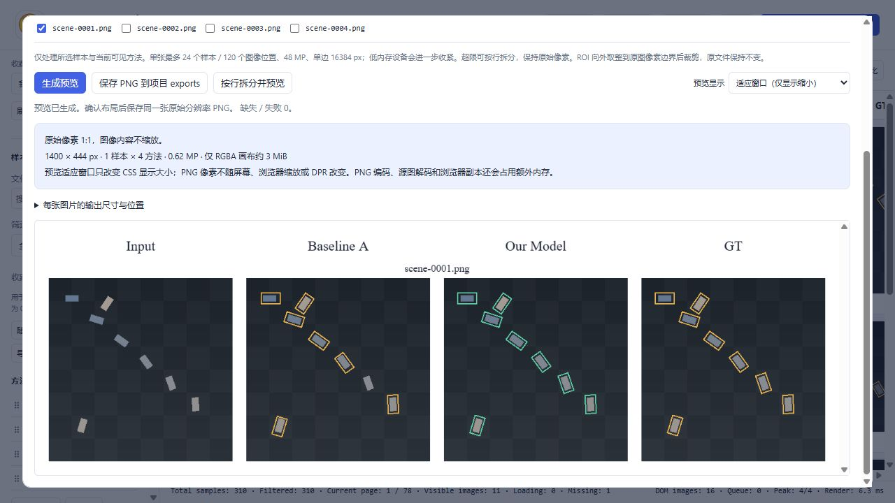

# Comparison Viewer

技术与使用报告 - 中文版 2.2.1

2.2.1 统一命名为 Comparison Viewer，加入中英文 README 切换，更新标识与合成截图，并修复 Windows 中文 CLI 编码；未增加分析功能。下文保留 2.1 / 2.2 实测基线。

作者：PolarisFTL 与 GPT 6 Astra。以本地目录为起点，对检测、分割、生成、增强等按样本对应的可视化结果进行比较、筛选与可信内网协作。RGB-T 是其中一个使用案例。

[PolarisFTL GitHub](https://github.com/PolarisFTL)

GPT 6 Astra 为 AI 编程协作署名，提供方为 OpenAI。下方为提供方网站，不是模型个人 GitHub 主页。

[OpenAI](https://openai.com/)

### 先配置，再分析

主机启动后首先进入目录配置页：填写数据集名称，选择 2-24 个方法目录和基准目录，给每列设置便于阅读的显示名。修改显示名不会重命名源文件夹。检查对应关系后，再进入查看器。


> Windows 提供便携 EXE 与源码入口；当前 macOS 交付为源码与 .command 启动器，不包含已经实机验收的 Mac .app。本报告中文使用宋体，拉丁文字使用 Times New Roman，PDF 内嵌字体子集；不发布系统字体文件。

## 01  macOS：从下载到打开

当前可用路径是源码启动。Windows 的 .exe 不能在 macOS 直接运行。将完整源码 ZIP 解压到你可写的目录，例如“文稿”中的一个项目文件夹；不要只下载 index.html，也不要从只读磁盘映像内运行。

### 准备 Python，并启动

1. 若未安装合适的 Python，从 python.org 的 macOS 下载页安装仍受支持的 Python 3.x，版本至少 3.9；本工具运行时只用标准库，不需要 npm 或 pip 安装运行依赖。官方安装程序包含可供 tkinter 使用的 Tk。

2. 双击 Start-macOS.command。它优先检测旁边的便携 .app（将来实际提供时），否则查找 Python 3.9+，启动服务并打开 /setup。保留终端窗口，关闭网页并不自动停止服务。

3. 如果只因为脚本执行权限无法双击，在“终端”中进入解压后的项目目录，对本项目的两份启动脚本执行：

```sh
chmod +x Start-macOS.command Start-LAN-macOS.command
```

然后重新双击；也可在该项目目录执行 bash Start-macOS.command。路径包含空格时使用引号，或将项目文件夹拖入终端辅助填入路径。

### 目录选择、Tk 与安全提示

4. 在配置页点击选择目录，在主机的系统对话框中选文件夹；或使用页面路径输入框粘贴目录绝对路径。若选择器报 tkinter / _tkinter 错误，可先运行 python3 -m tkinter 检查当前解释器，再使用官方 Python 安装程序或直接手填路径。不要用 pip install tkinter 修复标准库组件。

5. 如 macOS 拦截下载内容，先核实来源，再按系统“隐私与安全性”中的受控允许流程处理；不关闭 Gatekeeper，不删除系统 Python，不批量移除下载隔离标记。

未来的 .app 须在真实 macOS 或 macOS CI 构建，并分别说明 Intel / Apple Silicon 架构、签名和测试状态；单架构不能称为 Universal。Mac 实机与原生目录对话框 GUI 尚未验收，CI 以仓库实际记录为准。详细排障见 docs/MACOS.md。

[Python macOS 安装说明](https://docs.python.org/3/using/mac.html)

## 02  数据一致性与安全匹配

基准目录定义样本集合，每一行对应同一样本的不同方法输出。建议所有目录保留相同样本 ID 和相同场景内容；方法数量和显示名称可自由配置。

| 目录 | 对应文件 | 结果 |
| --- | --- | --- |
| Input（基准） | sample_001.jpg | 建立样本行 |
| Baseline | sample_001.jpg | 完整文件名优先 |
| Ours | sample_001.png | 主文件名唯一时匹配 |
| GT | 缺少对应文件 | Missing，不替代 |

### 不通过排序推断同一样本

优先完整文件名精确对应；扩展名不同且主文件名唯一时允许安全匹配。嵌套目录、重复主名和额外文件需看审计。歧义拒绝，不随机挑选，不把第 N 张配给第 N 张，也不擅自猜测前后缀。

以基准目录为全集，其他目录的额外文件不自动变成新样本。缺失会明确占位，可用于检查预测不完整；若要进行完整论文比较，应让各方法包含相同样本集合。

### 同名、同尺寸并不证明配准

RGB、红外、不同裁剪和不同画布边框可能具有不同几何关系。请在结果生成阶段保证视野和方向可比。查看器保持纵横比，不自动配准、不改变检测框、不修改预测置信度、不增强图片后冒充原始结果。

> 源图保持只读。配置、索引、审计、数据库、口令和导出写入 local/ 或显式 workspace，不放入公开源码包。文件头抽样不等于全量损坏检测，TIFF 等格式能否解码受浏览器支持限制，推荐 PNG / JPEG。

## 03  规模、按需加载与性能边界

关键是限制同时解码的像素，而不是让文件总数变少。目录扫描产生轻量索引，不把整库转为 Base64，不预创建全部 ImageBitmap，也不在启动时全量读取像素。

| 机制 | 控制的成本 |
| --- | --- |
| 当前页 DOM | 只创建这一页，换页不追加旧节点 |
| IntersectionObserver | 可见与边缘范围加载，横向离屏图移除 src |
| 4 任务队列 | 限制每个浏览器同时读取与解码任务 |
| 取消与引用释放 | 换页丢弃旧任务，撤销 Blob URL |
| 画布规模检查 | 导出前估算，只处理选定图像 |

### 真实数据索引基线

上一轮已实测 8,980 样本、10 方法、89,800 图片，缺失与歧义均为 0。索引扫描匹配 8.386 秒，包含工作区提交 9.628 秒，manifest 7,261,083 字节。抽样检查 357 个文件头，10 个代表原图前后哈希一致；没有逐文件全量像素完整性证明。

连续翻页 20 次，10 方法场景始终为 40 图像节点与 40 单元，错误 0，峰值并发 4。内部 render 6.0-9.4 ms 仅是 DOM 构建诊断；293-456 ms 含自动化 UI 调用，也不是整页原图加载时间。

> 资源成本随可见像素增长。默认 4 行、24 方法有 96 个单元，不能继续声称固定 40。12 张 840 × 712 RGBA 像素约 27.4 MiB，还不含索引、缓存、GPU 和编码。节点不累计不代表浏览器进程零增长，也不能承诺永不卡顿。

## 04  比较、筛选与制图工作流

默认每页 4 行，方法按列。搜索文件名、完整／缺失／收藏筛选、随机跳转和位置记忆帮助定位样本。列可以隐藏、排序、单列查看；表头与列一同横向滚动。



| 操作 | 用途与边界 |
| --- | --- |
| Ctrl + 滚轮 / 拖动 | 以指针缩放 / 平移；普通滚轮仍滚动页面 |
| 双击 / 1:1 | 适应容器 / 原始像素比例 |
| 同步：同一行或当前页 | 归一化视野；不是自动空间配准 |
| ROI / 双方法 | 框选、移动、重画；并排与同尺寸分割线 |
| 收藏 / 备注 / 标签 / 已审 | 保存人工判断，系统不自动评价算法优劣 |

快捷键：/ 聚焦搜索；输入框外左右方向键翻页；视口焦点下 + / - 缩放、0 适应；Esc 关闭弹窗。详情读取原图。系统文件定位只由主机执行，访问者不操作主机文件管理器。

## 05  原始像素导出与预览

新导出默认使用“原始像素 1:1（推荐）”；“自定义总宽（会缩放）”是明确的另一模式。原像素模式按每列最大原图宽、每行最大原图高安排单元，小图不放大，空余部分留白。ROI 向外取整到原图像素边界再以 1:1 取出。

### 840 × 712 的十列为什么不能塞进 3200px 而不缩小

仅十幅图像内容的总宽就需要 840 × 10 = 8400px，实际还要加列距和外边距。总宽 3200px 的十列拼图必然降低每幅图的像素数量。PNG 是无损编码，但不能恢复缩小前丢掉的信息；DPI 标签、显示缩放或高 DPR 也不会增加源像素。

当前默认布局中，4 样本 × 10 方法、每幅 840 × 712 的画布为 8592 × 3116，即 26,772,672 像素。仅 RGBA 画布约 102.13 MiB；读取原图、编码和预览还会额外占用内存。

| 参数 | 新导出约定 |
| --- | --- |
| 水平 / 垂直间距 | 默认各 16px；各自可调 0-256px |
| 外边距 | 默认 24px；可调 0-512px |
| 方法标题区 / 字号 | 默认 44px / 24px，文字不覆盖图像 |
| 样本编号区 / 字号 | 默认 32px / 18px，可隐藏 |
| 预览 | 适应视口或 100%；不改变最终 PNG 像素 |
| 规模保护 | 桌面最多 48MP，弱设备更严格；单边 16384 |

先选定样本和方法再预览，只对所选图读取有限文件头以估算布局，避免为尺寸解码两遍。JPEG EXIF 方向 1-8 纳入解释；实际解码尺寸不符则拒绝，不强拉伸。弱设备预算降至 24MP 或 12MP，单图也受约束；原像素超限应拆分，不偷偷降采样。

> 原像素几何、真实 PNG 与浏览器检查在 2.1 已完成，历史基线见验收页和 TESTING.md。此前 3200 × 1260 真图属于旧缩放基线，不是原像素结果。原图始终不修改、不增强。

## 06  可信内网协作与权限

默认只监听 127.0.0.1，端口 8770。需要分享时明确使用 LAN 启动器，依据真实私有 IPv4 和掩码限制网段；可以显式指定允许子网，不能假定整个校园网是同一个 /24。

| 角色 | 权限与记录 |
| --- | --- |
| 主机管理员 | 配置目录、索引、邀请与口令、系统定位、退出服务 |
| 访问者 | 口令登录；昵称 + 恢复码认领个人身份 |
| 独立标记 | 个人收藏、备注、标签和已审，不互相覆盖 |
| 集中汇总 | 主机 SQLite；按人、共同推荐和进度查看；JSON 备份 |

运行 Start-LAN-macOS.command 或 Start-LAN-Windows.bat，由主机复制实际邀请 URL 和口令。其他人只需浏览器，不需要 Python 或原目录盘符；但主机需开机、不休眠且持续运行服务。

### 网络能否互通需要现场检查

Windows 防火墙入站规则通常需 UAC；macOS 只在可信情况下按系统提示允许入站连接。仅放行实际端口与所需私有范围。无线客户端隔离、跨 VLAN、访客网和路由策略会阻止同校设备互通，不能仅凭同一校园网就承诺可达。

> HTTP 不加密。口令不是 TLS，不适合公网或不可信公共网络。Host、Origin、会话、变更令牌与索引白名单只是风险控制，不是安全审计。登录者可截图或下载授权图片，只向有数据访问权的人分享。

远程角色不得选择主机目录或执行主机管理。导出只处理授权样本。复制 SQLite 前停止服务或使用备份流程，避免遗漏 WAL；local/、凭据和实验数据不进入 GitHub。

## 07  验证状态、交付与参考

| 项目 | 2.1 Windows / Chromium 已完成基线 |
| --- | --- |
| Python 完整测试 | 95 项：94 通过、1 跳过（Windows 符号链接权限）；25.309 秒 |
| JavaScript 检查 | 40 项：36 项无依赖 Node 检查 + 4 项真实 Skia Canvas / PNG 回读 |
| Windows 2.1 便携 EXE | 13,680,469 字节，GUI 子系统<br>仅 Windows PATH 无 Python / Node；启动和原生 4×4 PNG 保存成功 |
| 混合尺寸 PNG | 865 × 621；16 单元逐像素与原图 RGB 相同，差异 0 |
| 鼠标框选 ROI | 426 × 90；4 单元坐标与尺寸均为整数、1:1，像素差异 0 |
| 真实 4 样本 × 10 方法 | 8592 × 3116 已保存；40 单元 840 × 712、scale 1、缺失失败 0 |
| 真实图像像素核验 | 本批 40/40 区域与原图经 PIL 解码后的 RGB 像素完全一致 |
| 超限与拆分 | 52.89MP 拒绝且无画布；拆为 7 行与 1 行，两份 PNG 均保存 |
| macOS / CI / 选择器 GUI | 未 Mac 实机、未远程 CI，原生对话框未操作验收 |

CSS 适应预览约 1149.95 × 417.05，但 PNG 仍为 8592 × 3116。像素核验只针对本批图像与该浏览器，不泛化为所有 ICC、透明度、EXIF 场景或压缩字节相同。HTTP 模拟身份不证明第二台校园网设备可达；旧 86 项／17 JS 属上一轮。详见 TESTING.md。

### 公开内容与许可

2.2.1 Windows 本地 Python 回归为 127 项：126 通过、1 符号链接权限跳过，49.001 秒，含 CP1252 下中文 CLI 输出检查；CI 状态以实际记录为准。此处上表仍为 2.1 历史基线。

公开包使用白名单，排除 local/、原图、口令、数据库、真实路径和私有截图。代码与文档 MIT；Los Pollos Hermanos 图像与商标属于第三方材料，不包含在 MIT 中，不声明官方关联、赞助或授权。详见 assets/README.md。

报告重建需 reportlab，以及合法可用的宋体和 Times New Roman。构建脚本从环境或系统字体目录查找，缺失时明确报错，不替换成 STSong。PDF 只嵌入所用字形子集，不将系统字体文件加入源码或发布 ZIP。

[项目发起者 PolarisFTL](https://github.com/PolarisFTL)

[Python 官方 macOS / Tk 说明](https://www.python.org/download/mac/tcltk/)

[Apple：打开未知开发者应用](https://support.apple.com/guide/mac-help/open-a-mac-app-from-an-unknown-developer-mh40616/mac)

配套文档：README.md / README_EN.md、docs/MACOS.md、QUICKSTART.md、ARCHITECTURE_PERFORMANCE.md、LAN_COLLABORATION.md、TESTING.md 和 PUBLISHING.md。

## 08  2.2：从大库到 MulimgViewer 小库

推荐流程：大库按需浏览 → 多人独立标记 → 推荐人数阈值 N → 确认样本与方法 → 按方法复制原图小库 → 复制本机路径 → MulimgViewer 排版。小库导出保留独立原文件，不是 PNG 拼图。

| 筛选 | 确切含义 |
| --- | --- |
| 任意人收藏 / 至少 N 人 | 至少 1 人收藏 / 收藏人数 ≥ N |
| 有备注或标签 | 任意人填写 note 或 tags |
| 全队未审 / 全部 | 无人标已审 / 全部样本；均可叠加文件名查询 |

团队汇总点击“批量导出原图”，先“预览导出范围”再确认。汇总仅展示前 200 行，批量导出处理全部匹配样本；默认全部方法，包含隐藏列，可主动选子集。推荐人数按身份计数，不自动判断模型优劣。

主机选已有可写输出目录，程序创建全新批次而不覆盖原图。访问者只能下载 ZIP 到自己电脑。方法显示名映射为跨系统安全目录名；原文件字节不重新编码，Missing 与失败写入报告。取消保留已完成副本及不完整报告，不自动删除。

### ZIP 路径要属于接收者电脑

完整解压后，在成功弹窗填“你电脑上已解压的批次目录”：该目录下面直接是方法文件夹。再下载 MulimgViewer 导入 CSV，可复制单个或全部方法路径。主机盘符不能在 Mac／另一台电脑使用；移动后重新准备路径。

专用 CSV 无表头，每行样本、每列方法，每格为当前电脑图片绝对路径；只含完整复制行。带表头 manifest.csv 是审计表，不能作图片列表；扩展名不同不假改后缀。paths.txt 仅含相对方法名，需与批次绝对路径拼接；report.json 保存状态和映射。

[MulimgViewer 官方读取代码（已核对格式）](https://github.com/nachifur/MulimgViewer/blob/master/src/mulimgviewer/src/data.py)

> 2.2 实测：310 合成样本、4 方法，三人收藏 310／240／205；N=3 导出 205 样本、819 文件、1 Missing，819 哈希均同源；兼容 CSV 为 204×4，ZIP 完整且无主机路径。现用 1503×10 数据隔离标记副本筛出 20 样本，200 原图 SHA256 全同，含验证 5.516 秒，仅此小批次。真实翻 20 页始终 40 img、无控制台错误；搜索与 N4=0 刷新恢复通过，4 路径剪贴板通过。2.2 纯 JS 65＋真实 Canvas 4 项通过，最终 Python 计数见 TESTING.md。Mac 与外部 GUI 未实机。
